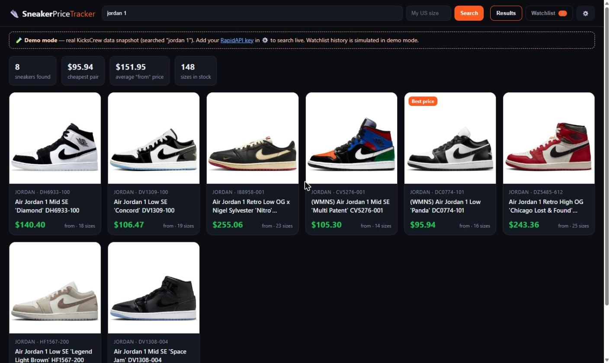
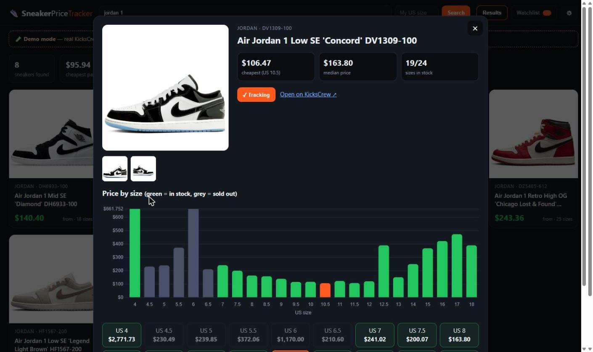
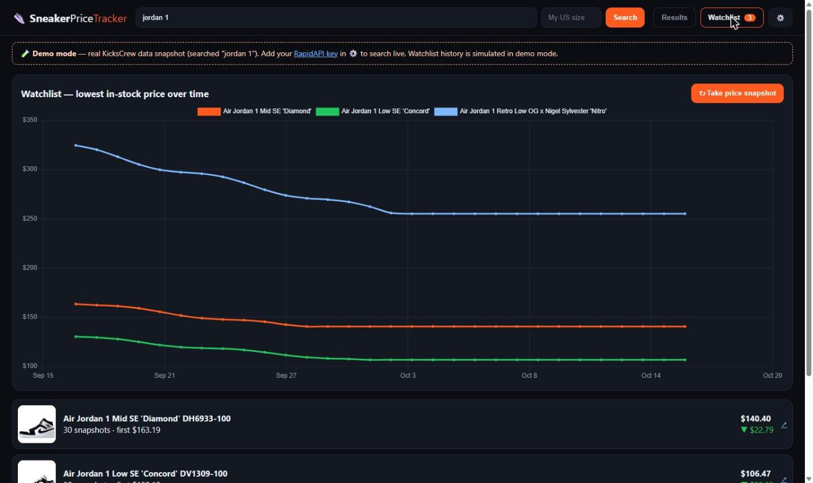

# 👟 Sneaker Price Tracker — see the price of every size & track price drops

[](https://rapidapi.com/belchiorarkad-FqvHs2EDOtP/api/kickscrew-sneakers-data)
[](https://t.me/pintoflow)
-success)


> 🔑 **Live data:** get a key for the **[KicksCrew Sneakers Data API on RapidAPI](https://rapidapi.com/belchiorarkad-FqvHs2EDOtP/api/kickscrew-sneakers-data)**
>
> 💬 **Support on Telegram: [@pintoflow](https://t.me/pintoflow)** — fastest response for questions, bugs or custom features.

An open-source **sneaker price tracker** web app. Search any sneaker (Jordan 1, Dunk Low, Yeezy 350, New Balance 550…), see **the price of every size** in a chart, find **the cheapest size / cheapest pair in your size**, and keep a **watchlist with price history**. Pure HTML + JS — open `index.html` and it works (demo data included).



| Price of every size | Watchlist & price history |
|---|---|
|  |  |

## Features

- 🔎 **Search** sneakers by name, model or style code (`DZ5485-612`)
- 📊 **Price-by-size bar chart** — green = in stock, grey = sold out, orange = cheapest
- 🎯 **“My size” mode** — cards show the price in *your* US size
- ⭐ **Watchlist** with price snapshots and a history line chart (stored in your browser)
- 🏷️ Best-price badge, stats (cheapest pair, average price, sizes in stock)
- 🤖 **Headless tracker** (`tracker/track-prices.js`) — logs your sizes to CSV every run and alerts on **price drops / restocks / target price** (console or Discord webhook)
- 🔐 **Zero-dependency proxy** (`server/proxy.js`) so your API key never reaches the browser
- 🧪 **Demo mode** with a real data snapshot — no key needed to try it

## Quick start

```bash
git clone https://github.com/BelNaruto/sneaker-price-tracker
cd sneaker-price-tracker
python3 -m http.server 8080      # or any static server / GitHub Pages
# open http://localhost:8080 → demo mode
```

**Live data:** click ⚙️ and paste your [RapidAPI key](https://rapidapi.com/belchiorarkad-FqvHs2EDOtP/api/kickscrew-sneakers-data) — or, for a public site, run the proxy:

```bash
RAPIDAPI_KEY=your-key node server/proxy.js     # http://localhost:8787
# ⚙️ → proxy URL = http://localhost:8787
```

**Price alerts (cron / GitHub Actions):** edit `tracker/watchlist.json`, then

```bash
RAPIDAPI_KEY=your-key DISCORD_WEBHOOK_URL=https://discord.com/api/webhooks/... node tracker/track-prices.js
```

```json
[{ "handle": "air-jordan-1-low-se-concord-dv1309-100", "sizes": ["9", "9.5", "10"], "targetPrice": 110 }]
```

## How it works

| Step | API endpoint |
|---|---|
| Search | `GET /search/v2?query=jordan 1&hitsPerPage=16&region=US&currency=USD` |
| Price of every size | `GET /product/description/byslugs?handle=…&country=US` → `variants.edges[].node.price.amount` + `availableForSale` |

A price of `0.0` means *no offer* for that size and is ignored. See the full API docs in [**kickscrew-sneakers-api**](https://github.com/BelNaruto/kickscrew-sneakers-api).

## Project structure

```
index.html, style.css, app.js   → the web app (no build step)
data/demo.json                  → real data snapshot used in demo mode
server/proxy.js                 → keeps your RapidAPI key server-side (+5 min cache)
tracker/track-prices.js         → headless tracker: CSV log + Discord alerts
tracker/watchlist.json          → sneakers / sizes / target prices to track
```

> Demo mode uses a real snapshot of KicksCrew data (search “jordan 1”). The watchlist **history in demo mode is simulated**; with a key, every snapshot is real.

## Related projects

- [kickscrew-sneakers-api](https://github.com/BelNaruto/kickscrew-sneakers-api) — API docs & examples (Node.js, Python, PHP, cURL)
- [sneaker-restock-monitor](https://github.com/BelNaruto/sneaker-restock-monitor) — Discord restock & price-drop monitor
- [sneaker-price-telegram-bot](https://github.com/BelNaruto/sneaker-price-telegram-bot) — Telegram sneaker price bot

---

💬 **Support on Telegram: [@pintoflow](https://t.me/pintoflow)** · 🔑 **API:** [https://rapidapi.com/belchiorarkad-FqvHs2EDOtP/api/kickscrew-sneakers-data](https://rapidapi.com/belchiorarkad-FqvHs2EDOtP/api/kickscrew-sneakers-data)

**Keywords:** sneaker price tracker, sneaker price checker, shoe price tracker, jordan price tracker, nike price tracker, sneaker size price, sneaker price drop alert, kickscrew api, sneaker api, stockx alternative.

MIT License · Not affiliated with KicksCrew.
